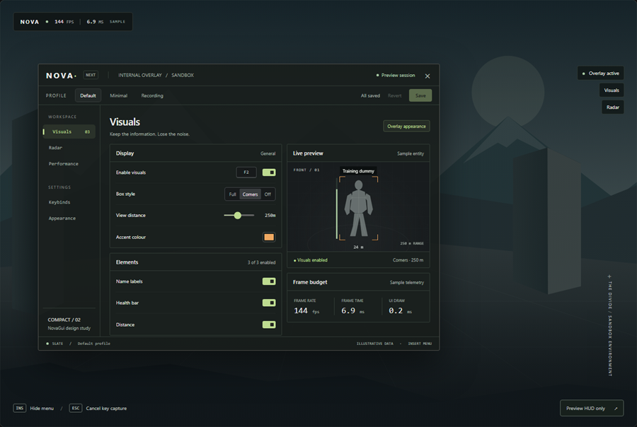
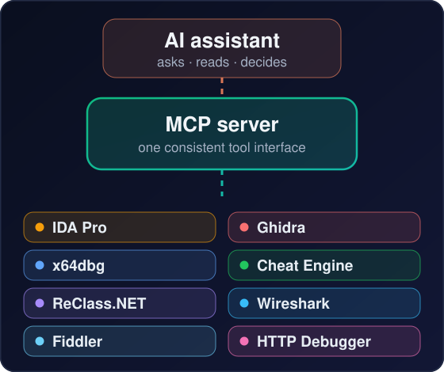
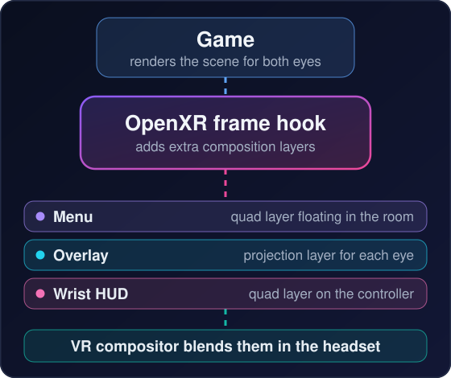

 

I like building things that feel fast and look good: **real-time graphics and game tech in C++**,
**reverse engineering and analysis**, **Microsoft 365 solutions**, and the **tools that tie it all together**.

Most of my work lives in private repositories, so this page is the overview:
what I build, how the pieces fit together, and what I'm working on now.

 

### ✨ What I work on

### 🌟 Featured

<table>
<tr>
<td width="52%" valign="middle"></td>
<td valign="middle">

#### NovaGui

My own immediate-mode GUI library in C++17. One codebase renders through **DirectX 9, 11 and 12, OpenGL and Vulkan**, and a universal menu template (rails, collapsible cards, keybinds, profiles, UI scaling) gives every overlay I build the same look and feel. More than 50 of my projects build their menu on it.

**The challenge:** identical output across five renderers and every resolution from 720p to 4K, with animation that stays smooth inside someone else's frame budget.

</td>
</tr>
<tr>
<td width="52%" valign="middle"></td>
<td valign="middle">

#### AI-assisted analysis tooling

A Model Context Protocol server that lets AI assistants work hands-on with real tools: decompiling in **IDA Pro** and **Ghidra**, stepping through code in **x64dbg**, reading live memory with **Cheat Engine** and **ReClass.NET**, and following traffic in **Wireshark** and **Fiddler**. It exposes more than 200 tools, including a patch-day check that re-finds every saved finding after a game updates.

**The challenge:** turning a dozen very different desktop tools into one consistent, safe interface an assistant can use reliably.

</td>
</tr>
<tr>
<td width="52%" valign="middle"></td>
<td valign="middle">

#### NovaGui inside the headset

The same menu and overlay, drawn in VR. Nothing touches the game's own images: an **OpenXR** frame hook adds extra composition layers instead. The menu is a panel floating in the room, the overlay is a projection layer for each eye, and a wrist HUD rides on the controller. The motion controllers drive all of it.

**The challenge:** drawing each eye with the game's own pose and field of view for that exact frame, so every mark stays locked to the world.

</td>
</tr>
</table>

### 🧩 More I've built

<table>
<tr>
<td width="50%" valign="top">

**One core, six games** 
A shared trainer core for a six-game series on one engine family. The menu, overlay, settings and keybinds are written once, and each game supplies only its own addresses and hooks.

</td>
<td width="50%" valign="top">

**Engine notes and playbook** 
A knowledge base that carries lessons from one project to the next: notes on nine engine families, a 16-part discovery playbook, and a method guide whose first rule is that a finding must hold on two independent instances.

</td>
</tr>
<tr>
<td width="50%" valign="top">

**NovaWall** 
A default-deny, per-application firewall for Windows, built on the Windows Filtering Platform with a NovaGui window. Arm it and nothing reaches the network until you allow it.

</td>
<td width="50%" valign="top">

**VEGAS NVENC fix** 
A small C++ fix that restores NVIDIA hardware encoding in VEGAS Pro 17 to 22, after newer drivers removed the presets those versions ask for. One click to install or remove.

</td>
</tr>
<tr>
<td width="50%" valign="top">

**LinkForge** 
A script for Adobe InDesign that sends every linked image to Photoshop to resize and convert, relinks the document, and restores frame scaling so the layout looks identical.

</td>
<td width="50%" valign="top">

**SharePoint and Teams tools** 
An SPFx web part that shows any HTML template from a document library in an auto-resizing iframe, and a Power Apps proof of concept that publishes alerts as real-time Teams notifications through Power Automate.

</td>
</tr>
<tr>
<td width="50%" valign="top">

**Review Map** 
A community map for location reviews: Leaflet on the front, Supabase with row-level security behind it, social login, video embeds and an admin moderation panel, hosted on Netlify.

</td>
<td width="50%" valign="top">

**Circle of Doom** 
A single-player arena-survival game for the browser, drawn on HTML5 Canvas, with a closing safe circle, upgrade drafts and boss encounters.

</td>
</tr>
</table>

### 🧰 Tech I use

### 🚀 Right now

<table>
<tr>
<td width="50%" valign="top">

### 🧠 How I work

I use AI heavily for prototyping and development, often several agents in parallel, alongside hands-on debugging, testing and reverse engineering. I enjoy working through unfamiliar systems, figuring out what's actually happening, and iterating until the result works.

- **Evidence first.** Every finding is labelled as proven in the running game, built but unconfirmed, or untested.
- **Built to survive updates.** Signatures instead of fixed addresses, and tooling that re-checks saved findings after a patch.

Along the way I keep short technical write-ups: the problem, what I tried, and what I learned.

</td>
<td width="50%" valign="top">

### 🤝 Open to

Microsoft 365 development, internal tools, workflow automation and developer tooling.

Always happy to compare notes on C++ interfaces, graphics and AI-assisted development.

</td>
</tr>
</table>

 

