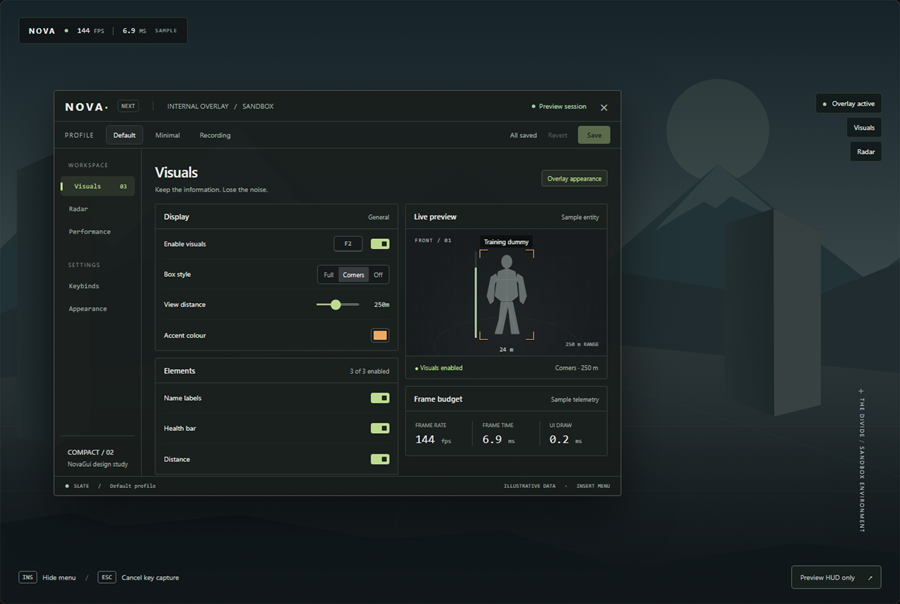
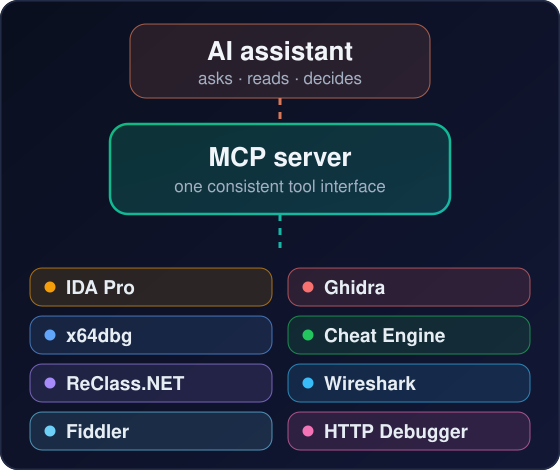

 

I like building things that feel fast and look good: **real-time graphics and game tech in C++**,
**reverse engineering and analysis**, **Microsoft 365 solutions**, and the **tools that tie it all together**.

 

### ✨ What I work on

### 🌟 Featured

<table>
<tr>
<td width="52%" valign="middle"></td>
<td valign="middle">

#### NovaGui

My own immediate-mode GUI library in C++17. One codebase renders through **DirectX 9, 11 and 12, OpenGL and Vulkan**, and a universal menu template (rails, collapsible cards, keybinds, profiles, UI scaling) gives every overlay I build the same look and feel.

**The challenge:** identical output across five renderers and every resolution from 720p to 4K, with animation that stays smooth inside someone else's frame budget.

</td>
</tr>
<tr>
<td width="52%" valign="middle"></td>
<td valign="middle">

#### AI-assisted analysis tooling

A Model Context Protocol server that lets AI assistants work hands-on with real tools: decompiling in **IDA Pro** and **Ghidra**, stepping through code in **x64dbg**, reading live memory with **Cheat Engine** and **ReClass.NET**, and following traffic in **Wireshark** and **Fiddler**.

**The challenge:** turning a dozen very different desktop tools into one consistent, safe interface an assistant can use reliably.

</td>
</tr>
</table>

### 🧰 Tech I use

### 🚀 Right now

<table>
<tr>
<td width="50%" valign="top">

### 🧠 How I work

I use AI heavily for prototyping and development, alongside hands-on debugging, testing and reverse engineering. I enjoy working through unfamiliar systems, figuring out what's actually happening, and iterating until the result works.

Along the way I keep short technical write-ups: the problem, what I tried, and what I learned.

</td>
<td width="50%" valign="top">

### 🤝 Open to

Microsoft 365 development, internal tools, workflow automation and developer tooling.

Always happy to compare notes on C++ interfaces, graphics and AI-assisted development.

</td>
</tr>
</table>

 

