 

I like building things that feel fast and look good: **real-time graphics and game tech in C++**,
**web apps for small businesses**, **Microsoft 365 solutions**, and the **tools that tie it all together**.

 

### ✨ What I work on

### 🧰 Tech I use

### 🚀 Right now

 

